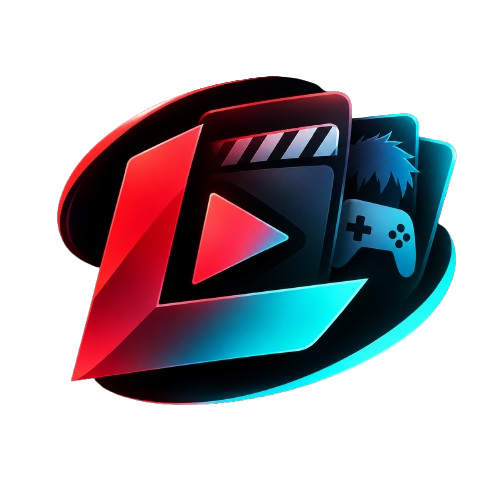

<div align="center">
  
  <h1>🎮🎬 Lierkour v2.3 — Keeper of Completed Media</h1>
  <p><strong>Local cross-platform catalog for movies, series, anime, and video games powered by Rust and Tauri 2</strong></p>

  <p>
    <a href="README.md"></a>
    <a href="README_EN.md"></a>
    <a href="https://github.com/LaRCorp/Lierkour/releases"></a>
    
    
    <a href="LICENSE"></a>
    <a href="https://github.com/LaRCorp/LierEX-Q"></a>
    <a href="https://github.com/LaRCorp/LierTags"></a>
    <a href="https://github.com/LaRCorp/LierSync"></a>
  </p>
</div>

**Lierkour** is a fast local desktop application built with **Tauri 2**, **React 19**, and **SQLite** for tracking your personal collection of movies, TV shows, anime, and video games — with full offline portability and zero cloud lock-in.

---

## Key Features

- **Movies, Series & Anime:** Hierarchical season cards, watch statuses, ratings (`1–10`), favorite quotes, screenshot galleries, and OMDb metadata lookup.
- **Video Games:** Platform & launcher tracking (Steam, GOG, Epic Games, Itch.io, Switch, PS5, etc.), playtime tracking, and game screenshot galleries.
- **Directed Title Relations:** Sequels, prequels, remakes, spin-offs, and franchise links.
- **Backups & Portability:** Full self-contained ZIP archives (`lierkour-backup.zip`), CSV & Markdown exports, and portable `run-portable.bat` / `run-portable.sh` launchers.
- **LIER Ecosystem Integration (v2.3):**
  - **Conflict-free Port Map:** Browser extension bridge runs on `127.0.0.1:8765`, Mobile Delta Sync runs on `0.0.0.0:8767` (freeing `:8766` for `LierTags`).
  - **LierSync (`:8768`):** One-click `lierkour-backup.zip` transfer to phone/PC plus sending posters or quotes straight to the shared clipboard.
  - **LierTags (`:8766`):** Send title metadata & artwork directly to soundtrack (OST) tagging or let LierTags search your Lierkour catalog.
  - **LierEX-Q (`:8765`):** 1-click import from Kinopoisk, IMDb, TMDb, Letterboxd, Steam, Epic Games, GOG, and Itch.io.

---

## Build from Source (Windows / Linux)

```bash
git clone https://github.com/LaRCorp/Lierkour.git
cd Lierkour

cd frontend
npm ci
npm run build
cd ..

cargo test --workspace
cargo build --release --features custom-protocol
```

---

## License

Released under **GNU General Public License v3.0 (GPLv3)** — see [LICENSE](LICENSE).

Copyright (c) 2026 LaRevole.

### Related Ecosystem Projects
- ⚡🔄 **[LaRCorp/LierSync](https://github.com/LaRCorp/LierSync)** — fast P2P file transfers, folder sync, and shared clipboard for PC & Android.
- 🌐 **[LaRCorp/LierEX-Q](https://github.com/LaRCorp/LierEX-Q)** — browser extension for extracting media cards, music tags, and pushing links/images to LierSync.
- 🎵🏷️ **[LaRCorp/LierTags](https://github.com/LaRCorp/LierTags)** — high-performance local audio tag & cover art editor built with Rust.
